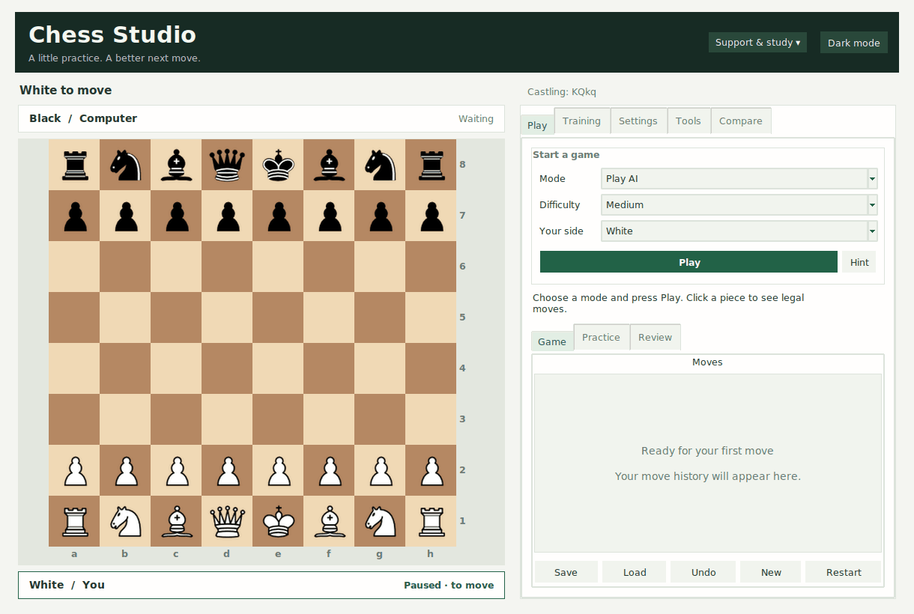
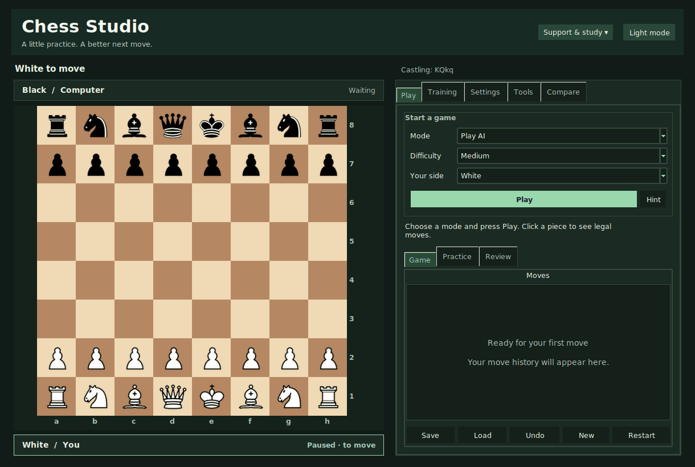

# Chess Studio appearance

The refreshed desktop uses warm neutral surfaces, emerald action buttons,
consistent typography, quiet panel borders and a dark header. Choose Dark mode
or Light mode in the header; the existing Settings → Appearance selector stays
in sync, and the choice is saved. Dark colors cover entry fields, move history,
read-only explanations, comboboxes, scrollbars, menus and report/coaching dialogs.

Player cards above and below the board show White/Black, your role, the side to
move and paused/game-over state. They follow board orientation. With a game clock
enabled, they also show remaining time; clock configuration stays in Settings.
Cards reuse their last rendering between changes to avoid redundant redraw work.

The empty move list explains where game history will appear, then hides that
message after the first move and brings it back after undoing to the start.
Primary Play, Start training and Run comparison actions use the accent color;
secondary actions stay visually quieter. Existing game/practice/review tabs,
keyboard shortcuts, large text, high-contrast board and piece styles remain.

Native notebook pages and scrollable Text widgets remain in use. There is no
scrolling canvas containing child controls, the path that previously caused
Windows ghosting. Board resizing still reuses square canvases and cached images.

Both editions use the same visual module, `chess/studio_appearance.py`. Download
rebuilt Windows/VS Code ZIPs to receive it; existing installed copies do not
automatically update. Preserve your full data folder when upgrading.

Screenshots show a temporary Linux desktop profile at 1220×820:

Validation covers palette persistence, dark text fields/dialogs, player cards
after turns/flips, empty-history transitions, board/game isolation, native text
scrolling and existing resize/keyboard regressions. Linux virtual-desktop and
Windows source/frozen tests provide automated evidence. Actual monitor scaling,
GPU/driver behavior and screen-reader testing remain on the manual checklist;
screenshots and synthesized inputs do not complete those checks.
